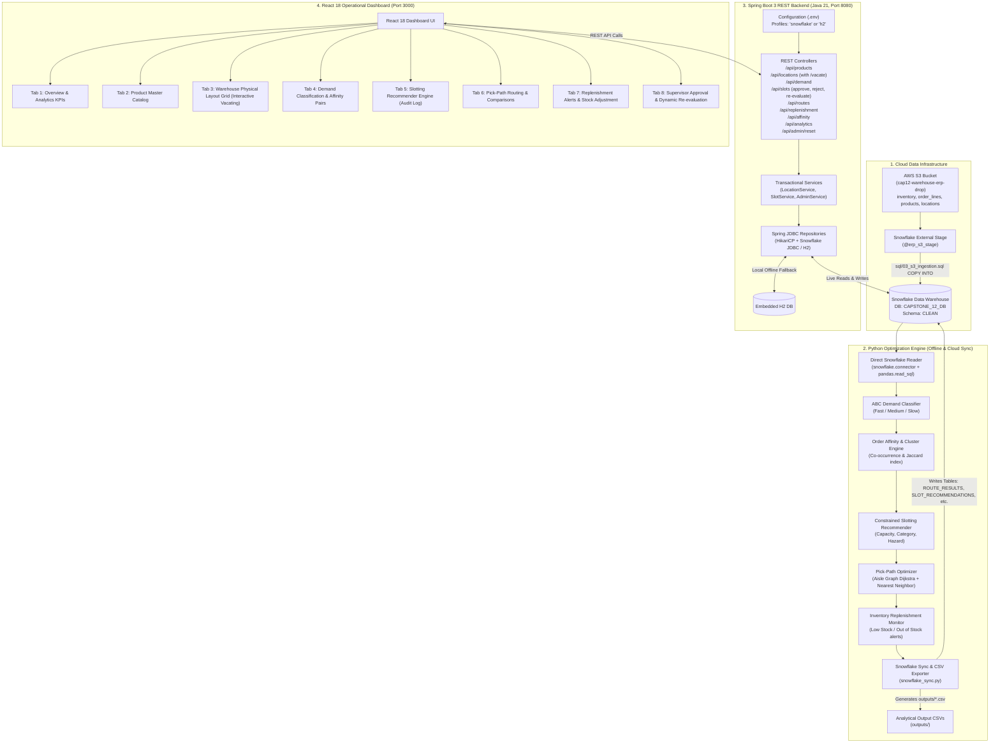

# CAP-12: Warehouse Slotting & Pick-Path Routing Optimization

An Enterprise Decision-Support System for Distribution Warehouses: Demand-Driven Slotting, Aisle-Network Pick-Path Routing, Storage Constraint Enforcement, Supervisor-in-the-Loop Governance, and Cloud Data Warehouse Integration.

---

## 1. Executive Summary & Problem Statement

Modern fulfillment and distribution warehouses handle hundreds of stock-keeping units (SKUs) across multi-aisle physical racking. Suboptimal slot placement and sequential picking paths inflate worker travel distance, cause aisle congestion, increase labor costs, and delay order fulfillment cycle times.

**CAP-12** is an end-to-end, full-stack decision-support platform designed to resolve these bottlenecks:
1. **Demand-Driven Storage Slotting**: Classifies SKUs into **Fast**, **Medium**, and **Slow** velocity movers using historical order-line frequency and assigns optimal slots closer to the dispatch area while strictly enforcing physical rack capacity, allowed category, and hazard class constraints (e.g., General, Hazmat Battery, Hazmat Flammable).
2. **Product Affinity Clustering**: Identifies frequently co-ordered SKU pairs (Market Basket Analysis) to position complementary items in adjacent or neighboring bays.
3. **Aisle-Constrained Pick-Path Routing**: Implements shortest-path aisle graph traversal (Dijkstra algorithm) and Nearest Neighbor (NN) heuristics, comparing dual optimizations (Route-Only, Slot-Only, and Dual Optimization) against baseline sequential picking.
4. **Supervisor-in-the-Loop Governance**: Prevents unvetted algorithmic overrides by requiring supervisor review. Approvals and rejections are transactionally audited with timestamps and persisted directly to the database.
5. **Dynamic Re-Slotting & Interactive Vacating**: Supervisors can inspect physical bins, vacate occupied slots, and trigger real-time re-evaluations that pair newly emptied bins with eligible candidate or unassigned SKUs.
6. **Enterprise Cloud Integration**: Direct ingestion from AWS S3, storage and transformation in Snowflake Data Warehouse (`CAPSTONE_12_DB.CLEAN`), and dual-profile Spring Boot backend (Snowflake JDBC vs. embedded H2).

---

## 2. End-to-End System Architecture



---

## 3. Technology Stack

| Layer | Technologies & Frameworks | Description |
| :--- | :--- | :--- |
| **Cloud Data Warehouse** | Snowflake (`CAPSTONE_12_DB.CLEAN`), AWS S3 | Cloud storage, external stages, and analytical data warehouse |
| **Data Ingestion** | Snowflake SQL (`COPY INTO`), Stage `@erp_s3_stage` | Direct ETL ingestion from S3 CSV drops into Snowflake tables |
| **Optimization Core** | Python 3.11, NumPy, Pandas, NetworkX | Algorithmic slotting, ABC classification, Dijkstra shortest path |
| **Data Connectors** | `snowflake-connector-python`, Python `python-dotenv` | Direct SQL-based read/write pipeline between Python and Snowflake |
| **Verification & Testing**| Pytest (33 unit & integration tests) | Validates demand rules, capacity, hazard constraints, routing math |
| **Backend REST API** | Java 21, Spring Boot 3.4.3, Spring JDBC, HikariCP | Transactional REST API with dual profiles (`snowflake` & `h2`) |
| **Frontend UI** | React 18, Axios, Babel Standalone, Modern CSS | 8 operational dashboard tabs with live database synchronization |
| **Audit & Tooling** | Python verification scripts | `check_snowflake_approval.py`, `reset_snowflake_baseline.py` |

---

## 4. Database Schema & Tables

Both Snowflake Cloud (`CAPSTONE_12_DB.CLEAN`) and embedded H2 share consistent relational schemas:

### Core Warehouse Tables (Ingested from S3)
1. **`WAREHOUSE_LOCATIONS`** (40 bins):
   - `LOCATION_ID` (PK, e.g., `A01` - `E08`)
   - `AISLE` (`A`, `B`, `C`, `D`, `E`)
   - `X`, `Y`: 2D warehouse coordinates relative to Dispatch Point `(0, 0)`
   - `CAPACITY`: Physical storage volume (units)
   - `STATUS`: `OCCUPIED` or `EMPTY`
   - `ALLOWED_CATEGORY`: `ALL`, `ACCESSORIES`, or `ELECTRONICS`
   - `HAZARD_ALLOWED`: `GENERAL`, `HAZMAT_BATTERY`, or `HAZMAT_FLAMMABLE`
2. **`PRODUCTS`** (30 SKUs):
   - `SKU_ID` (PK, `SKU001` - `SKU030`)
   - `PRODUCT_NAME`, `CATEGORY` (`Computing`, `Electronics`, `Accessories`, etc.)
   - `REQUIRED_CAPACITY`: Space consumed per batch
   - `CURRENT_LOCATION`: Assigned bin or `'UNASSIGNED'`
   - `HAZARD_CLASS`: `GENERAL`, `HAZMAT_BATTERY`, `HAZMAT_FLAMMABLE`
3. **`INVENTORY`**:
   - `SKU_ID` (PK), `CURRENT_STOCK`, `MINIMUM_STOCK`
4. **`ORDER_LINES`**:
   - `ORDER_LINE_ID` (PK), `ORDER_ID`, `ORDER_DATE`, `SKU_ID`, `QUANTITY`

### Analytical & Optimization Tables
5. **`DEMAND_ANALYSIS`**: SKU demand class (`Fast`, `Medium`, `Slow`), order frequencies, demand volatility ($CV$).
6. **`ORDER_AFFINITY`**: Co-occurrence counts, affinity scores, and Jaccard similarity indices between SKU pairs.
7. **`SLOT_RECOMMENDATIONS`**: Recommendation proposals (`RECOMMENDED`, `APPROVED`, `REJECTED`, `NO_FEASIBLE_LOCATION`), proposed bins, distance savings, and audit timestamp `UPDATED_AT`.
8. **`ROUTE_RESULTS`**: 50 orders comparison across 4 routing approaches (`BASELINE_DISTANCE`, `ROUTE_ONLY_DISTANCE`, `SLOT_ONLY_DISTANCE`, `OPTIMIZED_DISTANCE`, `DISTANCE_SAVED`, `PCT_DISTANCE_REDUCTION`, `TIME_SAVED_SEC`).
9. **`REPLENISHMENT_ALERTS`**: Triggered stock alerts (`OUT_OF_STOCK`, `LOW_STOCK`, `REPLENISHMENT_REQUIRED`).

---

## 5. Core Algorithms & Methodology

### 5.1 ABC Demand Classification
SKUs are categorized by order frequency across historical transactions:
- **Fast Movers**: Frequency $\ge 10$ orders $\to$ prioritized for depot-proximal bays.
- **Medium Movers**: Frequency between $4$ and $9$ orders.
- **Slow Movers**: Frequency $< 4$ orders $\to$ stored in rear aisles.

### 5.2 Storage Slotting Optimization & Constraint Validation
A slot relocation proposal is generated only when all hard constraints are satisfied:
1. **Physical Capacity**: $\text{Location Capacity} \ge \text{Product Required Capacity}$.
2. **Category Restriction**: Location `ALLOWED_CATEGORY` is `ALL` or matches product `CATEGORY`.
3. **Hazard Compliance**: Product `HAZARD_CLASS` matches location `HAZARD_ALLOWED`.
4. **Distance Reduction**: Relocation must yield a positive travel reduction ($\ge 5.0$ units) to justify physical warehouse relocation labor.
5. **Dispatch Proximity Ranking**: Prioritized by velocity and sorted by shortest-path aisle distance to Dispatch Point `(0, 0)`:
   $$\text{Aisle Distance} = \text{Dijkstra}(\text{Dispatch}, \text{Target})$$

### 5.3 Pick-Path Routing: 4-Way Operational Comparison
For every order batch, the engine evaluates 4 routing scenarios:
1. **Baseline**: Sequential pick route in order of receipt on the pick sheet.
2. **Route-Only (Nearest Neighbor)**: TSP heuristic on current slot layout.
3. **Slot-Only**: Sequential pick path on optimized slot layout.
4. **Dual Optimization (Slot + Route)**: Nearest Neighbor route on optimized slot layout.

### 5.4 Supervisor Approval & Dynamic Re-Slotting
- Changes are never automatically committed without human approval.
- When an approval is granted:
  - Product `CURRENT_LOCATION` is updated to the proposed bin.
  - Target bin is marked `OCCUPIED`.
  - Prior bin is marked `EMPTY`.
  - **Reactive Re-Slotting**: The vacated bin is evaluated to see if another SKU can benefit from moving into it.
- When a slot is vacated via Tab 3:
  - Database marks the location as `EMPTY` and unassigns the product.
  - Clicking **"⚡ Re-evaluate Empty Slots"** rescans all empty slots and matches eligible candidates.

---

## 6. Project Structure

```
devops_capstone/
├── .env.example                       # Environment configuration template
├── pytest.ini                         # Pytest configuration
├── requirements.txt                   # Python dependencies
├── backend/
│   ├── mvnw.cmd                       # Maven wrapper (Windows)
│   ├── pom.xml                        # Spring Boot dependencies & profiles (h2, snowflake)
│   └── src/main/
│       ├── java/com/cap12/warehouse/
│       │   ├── controller/            # REST Controllers (Location, Slot, Route, Admin, etc.)
│       │   ├── dto/                   # DTOs (AnalyticsDto, DemandItemDto, ApprovalResponseDto)
│       │   ├── model/                 # Domain Records (Product, WarehouseLocation, etc.)
│       │   ├── repository/            # Spring JDBC Repositories
│       │   └── service/               # Transactional Business Services
│       └── resources/
│           ├── application.properties # Base configuration & H2 profile
│           ├── application-snowflake.properties # Snowflake cloud profile
│           ├── schema.sql             # Relational DDL
│           └── data.sql               # Seed data
├── datasets/
│   ├── cleaned/                       # Local offline CSV fixtures for tests
│   └── original/                      # Source ERP drops
├── frontend/
│   ├── index.html                     # Synchronized dashboard entrypoint
│   ├── package.json
│   ├── server.js                      # Local Node static server (port 3000)
│   ├── public/
│   │   ├── index.html                 # Active dashboard single-file bundle
│   │   └── seed_data.js               # Standalone preview seed snapshot
│   └── src/
│       ├── App.jsx                    # React main orchestrator
│       ├── api/warehouseApi.js        # Axios / Fetch client
│       └── components/                # 8 Modular dashboard components
├── outputs/                           # Generated analytical CSV files
│   ├── affinity_matrix.csv
│   ├── affinity_pairs.csv
│   ├── baseline_routes.csv
│   ├── demand_analysis.csv
│   ├── optimized_routes.csv
│   ├── route_comparison.csv
│   └── slot_recommendations.csv
├── scripts/
│   ├── check_snowflake_approval.py    # Snowflake audit checker script
│   ├── fix_snowflake_schema.py        # Schema validation helper
│   └── reset_snowflake_baseline.py    # Baseline restore script
├── sql/
│   ├── 01_create_result_tables.sql    # Analytical DDL in Snowflake
│   ├── 02_create_views.sql            # Power BI analytical views
│   ├── 03_load_results.sql            # Table loading statements
│   ├── 03_s3_ingestion.sql            # S3 COPY INTO ingestion scripts
│   └── snowflake_complete_setup.sql   # Complete all-in-one Snowflake setup
├── src/optimization_engine/
│   ├── aisle_network.py               # Graph builder & Dijkstra algorithm
│   ├── data_loader.py                 # Snowflake direct read & CSV loader
│   ├── demand_classifier.py           # ABC classification logic
│   ├── main.py                        # Optimization pipeline runner
│   ├── pick_path.py                   # Route optimizer & comparisons
│   ├── slot_recommender.py            # Constrained slot allocator
│   ├── snowflake_sync.py              # Snowflake Cloud sync engine
│   └── validation.py                  # Replenishment alerts & validation
└── tests/
    ├── test_affinity.py               # Affinity & market basket tests
    └── test_optimization_engine.py    # 30 unit & algorithmic tests
```

---

## 7. How to Run & Verify

### 7.1 Environment Setup (`.env`)

Create a `.env` file in the project root (`devops_capstone/.env`) based on `.env.example`:

```bash
cp .env.example .env
```

Populate your Snowflake and AWS credentials:
```ini
# Snowflake Connection Details
SNOWFLAKE_ACCOUNT=your_account_identifier
SNOWFLAKE_USER=CAPSTONE_SERVICE_USER
SNOWFLAKE_PASSWORD=your_password
SNOWFLAKE_DATABASE=CAPSTONE_12_DB
SNOWFLAKE_SCHEMA=CLEAN
SNOWFLAKE_WAREHOUSE=CAP12_WH
SNOWFLAKE_ROLE=ACCOUNTADMIN

# AWS S3 Storage & Stage Settings
AWS_S3_BUCKET=cap12-warehouse-erp-drop
SNOWFLAKE_STAGE=erp_s3_stage
access_key=your_aws_access_key
secret_access_key=your_aws_secret_key
```

---

### 7.2 Run Python Optimization Engine & Test Suite

1. **Activate Python Virtual Environment & Install Dependencies**:
   ```powershell
   .\venv\Scripts\Activate.ps1
   pip install -r requirements.txt
   ```

2. **Run Pytest Test Suite (All 33 tests)**:
   ```powershell
   pytest tests/
   ```
   *Expected: `33 passed in ~3s`.*

3. **Run Full Optimization Pipeline (Reads from Snowflake $\to$ Computes $\to$ Writes to Snowflake)**:
   ```powershell
   python -m src.optimization_engine.main
   ```

---

### 7.3 Run the Spring Boot Backend (Java 21)

Navigate to the `backend/` directory:
```powershell
cd devops_capstone/backend
```

#### Option A: Snowflake Cloud Mode (Enterprise Profile)
Directly reads and transactionally writes to your live Snowflake instance:
```powershell
.\mvnw.cmd spring-boot:run -Psnowflake
```
*Port: `http://localhost:8080`. Connects to `CAPSTONE_12_DB.CLEAN` using credentials from `.env`.*

#### Option B: Local Embedded H2 Mode (Zero-Dependency Offline Profile)
Runs against an in-memory embedded H2 database populated from seed data:
```powershell
.\mvnw.cmd spring-boot:run -Ph2
```
*Port: `http://localhost:8080`. H2 Web Console available at `http://localhost:8080/h2-console`.*

---

### 7.4 Run the React Frontend Dashboard

1. **Start the Frontend Server**:
   ```powershell
   cd frontend
   node server.js
   ```
2. **Access Dashboard in Browser**:
   Open **`http://localhost:3000`** in your browser.
   *(Alternatively, opening `frontend/public/index.html` directly in any browser works seamlessly).*

---

### 7.5 Verify Snowflake Approvals in Real Time

To verify that approvals made on the dashboard are actively persisted to Snowflake Cloud:
```powershell
cd devops_capstone
.\venv\Scripts\python.exe scripts/check_snowflake_approval.py
```
*Output displays active connection confirmation and lists all approved recommendations with audit timestamps.*

---

## 8. REST API Reference

| Method | Endpoint | Description |
| :--- | :--- | :--- |
| `GET` | `/api/products` | Retrieve all 30 product records |
| `GET` | `/api/locations` | Retrieve all 40 warehouse storage bins with status and coordinates |
| `POST` | `/api/locations/{locationId}/vacate` | **Transactional**: Vacates a slot to `EMPTY`, unassigns product, triggers reslotting |
| `GET` | `/api/demand` | Retrieve SKU demand classification summary and frequencies |
| `GET` | `/api/slots/recommendations` | Retrieve all candidate slot recommendations |
| `POST` | `/api/slots/approve/{id}` | **Transactional**: Approves recommendation, updates bin statuses, runs reactive reslotting |
| `POST` | `/api/slots/reject/{id}` | **Transactional**: Rejects proposal, preserves current location, seeks next candidate |
| `POST` | `/api/slots/re-evaluate` | **Transactional**: Scans all available empty slots and matches candidate SKUs |
| `GET` | `/api/routes` | Retrieve all 50 order route comparisons (4 routing scenarios) |
| `GET` | `/api/routes/{orderId}` | Retrieve route stops and path coordinates for an order |
| `GET` | `/api/routes/comparison/{orderId}` | Detailed comparative metrics for a single order |
| `GET` | `/api/replenishment` | Retrieve real-time inventory alerts (Out of Stock / Low Stock) |
| `GET` | `/api/affinity` | Retrieve SKU co-occurrence affinity pairs and Jaccard scores |
| `GET` | `/api/analytics` | Retrieve executive KPIs (average reduction, total saved, counts) |
| `POST` | `/api/admin/reset` | **Transactional**: Resets warehouse database back to initial seed baseline |

---

## 9. Key Results Summary

- **Total SKUs Profiled**: 30 products
- **Total Physical Locations**: 40 bins (30 occupied, 10 available empty)
- **Feasible Recommendations**: 5 high-impact relocations with positive travel reduction (+10 to +25 distance units saved per pick)
- **Pick-Path Travel Reduction**:
  - Baseline Average Travel Distance: **122.2 units**
  - Dual-Optimized Travel Distance: **100.8 units**
  - Average Distance Reduction: **15.6%**
  - Total Distance Saved (50 orders): **1,068+ units**
- **Test Integrity**: 33 of 33 unit tests passing (`pytest tests/`)
- **Audit Compliance**: Zero hardcoded credentials; strict separation of environment secrets and clean Git versioning.
